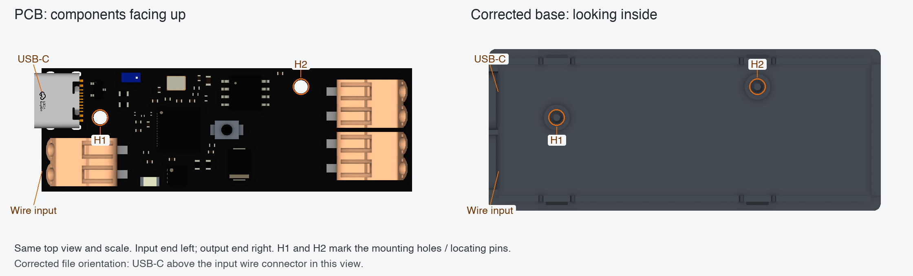
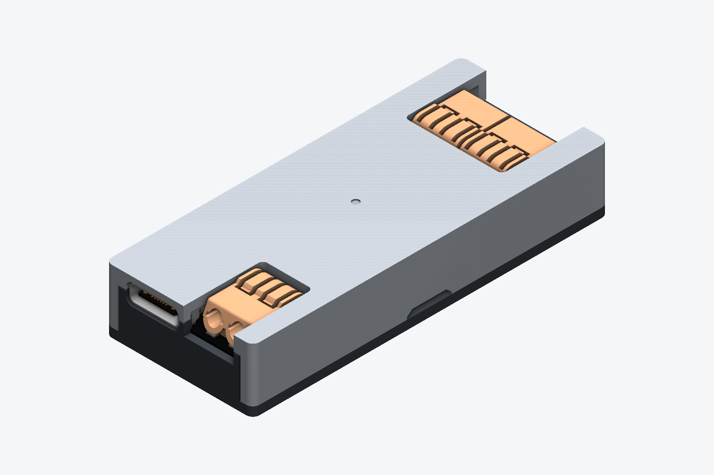
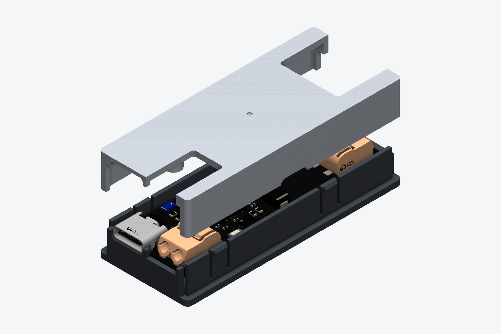
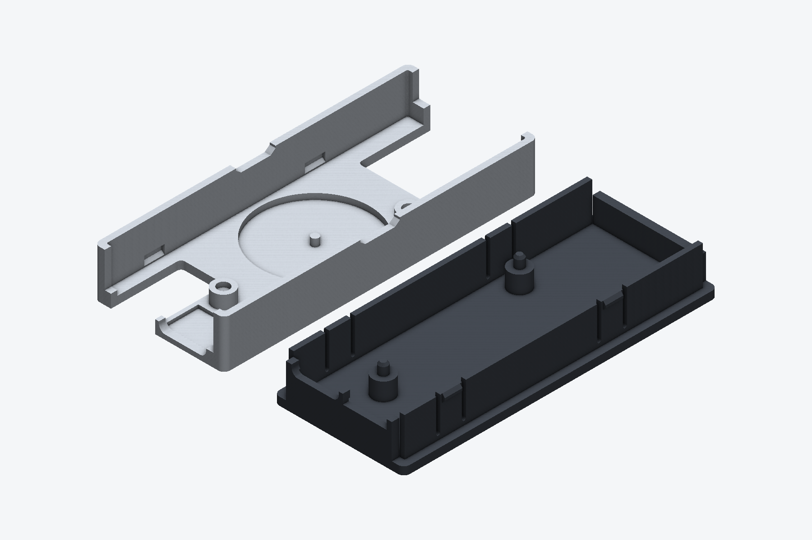

# LX0001 v1.0.0 enclosure

Viewed into the base with the input end on the left, USB-C is at the upper left and the wire input at the lower left. The two locating pins match the PCB holes in this same view. The lid is supplied roof-down for printing; turn it over for assembly. Import the corrected files without applying another mirror operation.

Two printed parts, with no screws, inserts or separate button. Outside dimensions: **63.45 × 26.30 × 11.30mm**. The lid is nominally flush with the 4.5mm-high wire connectors.

Both long walls are continuous flat faces. The lid includes the outer corners; the stepped assembly joints are on the connector end faces, with clearance for the two halves to fit together.

The terminal top openings run straight through to the end ports. Their side faces have no projecting lips; only the inboard corners are rounded.

| Closed | Exploded | Inside / print orientation |
| --- | --- | --- |
|  |  |  |

## Files

| File | Purpose |
| --- | --- |
| [LX0001-case-print-layout.3mf](LX0001-case-print-layout.3mf) | Both printable parts, arranged and oriented. Geometry only; select your printer and PLA profile before slicing. |
| [base.stl](base.stl), [lid.stl](lid.stl) | Individual printable parts, already oriented on Z=0. Units are mm. |
| [LX0001-case.skp](LX0001-case.skp) | Native SketchUp assembly with separate Base, Lid and PCB reference groups. |
| [LX0001-case-exploded.skp](LX0001-case-exploded.skp) | Same groups, with the lid raised for inspection. |
| [LX0001-case-print-layout.skp](LX0001-case-print-layout.skp) | Only the two printable parts, arranged side by side. |
| [LX0001-case-assembly.step](LX0001-case-assembly.step) | Solid CAD assembly of the two case halves, without the PCB. |
| [base.step](base.step), [lid.step](lid.step) | Individual solid CAD parts in print orientation. |

`pcb-reference.stl` is a fit reference, not a printable part. `base-assembly.stl` and `lid-assembly.stl` are positioned for visualization; use `base.stl` and `lid.stl` for printing. SketchUp groups contain editable mesh geometry; the dimension parameters are in `../../../Source/Enclosure/parameters.json`.

## Print

- PLA, 0.4mm nozzle, 0.1mm first layer and subsequent layers; 100% scale. This preserves the 9.7mm lid height without rounding it to a 0.2mm layer grid.
- Keep the supplied orientation: base floor down, lid outside face down. Both print as open cups.
- Supports off. Do not enable automatic orientation.
- Reference slicing used 2 walls, 15% infill, 6 bottom layers (0.6mm) and 10 top layers (1.0mm). Use your own printer/filament temperatures and speeds.
- The flexible button membrane is 0.4mm thick: retain four 0.1mm layers there. Check the first-layer calibration and layer preview before printing.

The 3MF includes no printer-specific settings or executable G-code. No print has been started remotely.

## Assembly and use

1. Let both prints cool, remove any strings, and check that the four wall clips can move freely.
2. Place the PCB on the two base supports, with the locating pins through its mounting holes. Align the USB-C and input wire connector with the input end.
3. Lower the lid and press near the four clips, alternating sides. The lid posts capture the PCB at its mounting holes; the wall clips hold the case closed.
4. Check that a USB plug seats fully and the BOOT switch is released at rest. Press gently at the small center mark to operate BOOT.
5. Reach the wire-release tabs through the two top windows. The input window covers one connector; the output window covers two.

To reopen, use the small fingernail notches along the lower long edges and ease the lid up gradually on both sides. Avoid forcing a single corner or pressing the flexible button to remove the lid.

## Fit and verification

- PCB nominal size: 60 × 20 × 1.6mm. Locating pins: Ø1.8mm in the existing Ø2.2mm holes. Nominal PCB capture space: 1.82mm.
- Four PLA wall clips use 0.25mm nominal engagement. Case wall fit clearance: 0.25mm per side.
- USB opening: 9.54 × 3.76mm with R1.30 corners. Clearance is 0.30mm at each side, 0.20mm below and 0.40mm above the nominal connector; the small upward bias accommodates PCB movement. A local internal roof recess also clears the connector. Width and height come from the DEALON drawing. The nominal R1.0 shell corner is inferred from the shared library model, because the DEALON drawing does not dimension it; this is not a manufacturer-certified exact contour.
- Terminal windows have 0.40mm nominal clearance at their inboard ends and 0.50mm along their sides. The side cuts align with the end ports. Connector and PCB tolerances can leave the terminals slightly above or below the lid.
- BOOT uses a continuous Ø22mm diaphragm and an integrated plunger. Nominal rest gap is 0.60mm, reducing to 0.38mm at maximum nominal PCB lift. There is no validated mechanical overtravel stop.

The final CAD was checked against the populated PCB model: no component/case collisions and no overlap between the two halves. Both print meshes are single, watertight bodies. A 0.0012mm PCB-seat overlap comes from the exported PCB datum and is documented in the mechanical report.

Both halves were actually sliced in Bambu Studio with supports disabled, and the layer paths were checked. Native SketchUp files were saved and reopened to verify geometry, dimensions and mm units. Reports are in `Validation/` and `sketchup-verification.json`.

**Prototype:** this geometry has not yet been physically fitted. Click force, button travel, repeated flexing and operating temperature still need physical testing. Fit the received PCB and cable before printing a batch. The connector openings are intentional; the enclosure is not sealed or waterproof.
