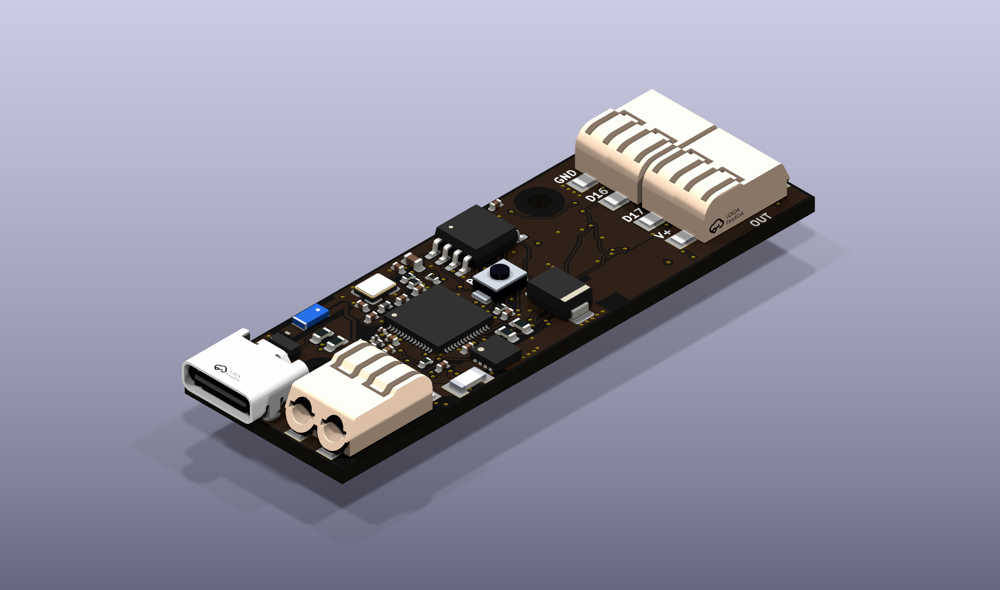
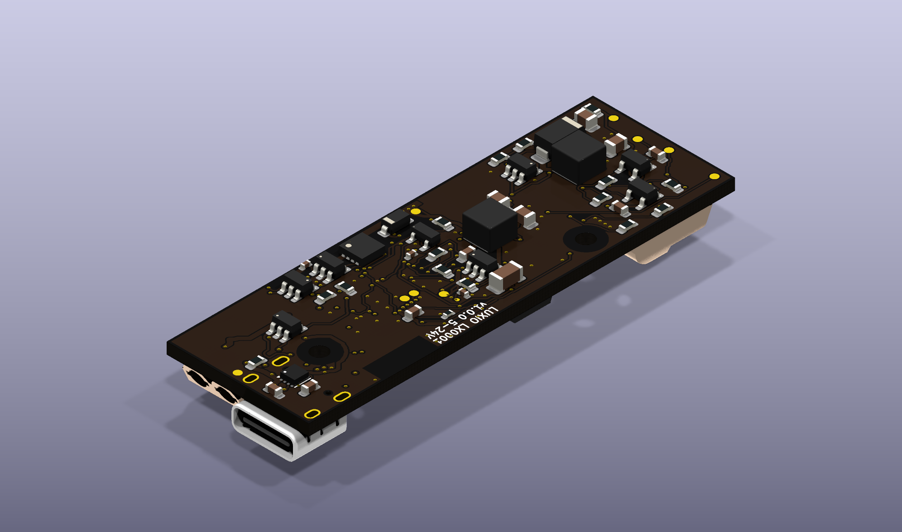
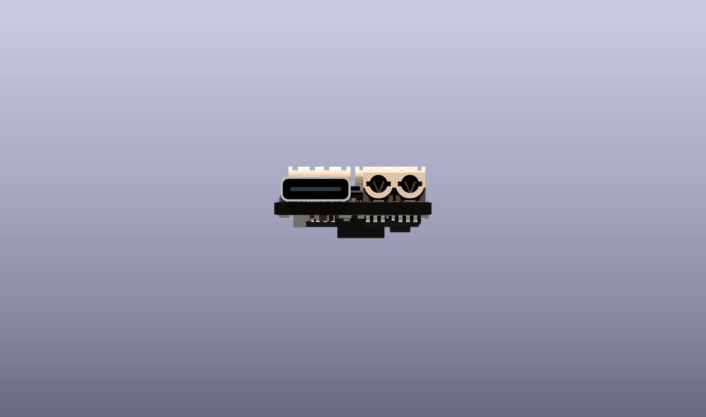
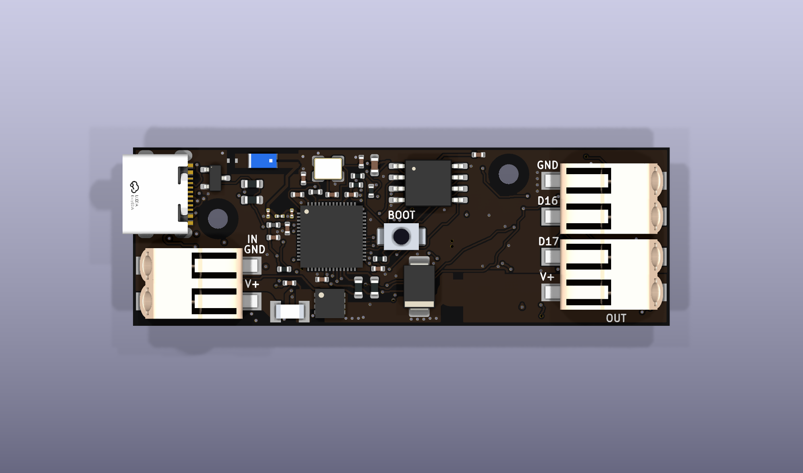
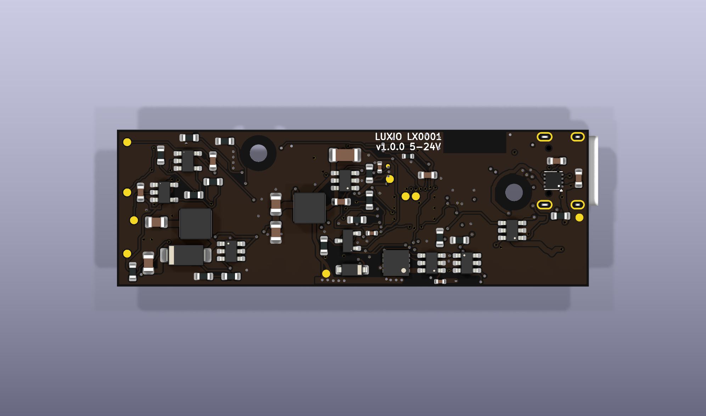

# LX0001 · v1.0.0

A compact ESP32-S3 controller for addressable LED strips, with two 5V logic
outputs, Wi-Fi, native USB and automatic wired-input priority.

### 3D views

| | | |
| --- | --- | --- |
|  |  |  |
|  |  | |

### Hardware

| Item | Specification |
| --- | --- |
| Board | 60 × 20 mm, 4 layers, 1.6 mm FR-4 |
| Appearance | Black solder mask, white silkscreen, ENIG |
| MCU | ESP32-S3, external 4 MB flash, no PSRAM |
| Wireless | 2.4 GHz Wi-Fi with ceramic antenna |
| Wired input | 5–24V DC; designed for a 5 A continuous strip load, pending thermal validation |
| USB | USB-C, native USB 2.0 data and 5V power; no USB PD |
| LED signals | GPIO16 and GPIO17 translated from 3.3V to 5V |
| Button | Centered BOOT / GPIO18 user button |
| Wire connectors | HDGC 2060-452-HDGC, JLCPCB C55251566 |
| USB connector | DEALON USB-TYPE-C-018, JLCPCB C2927038 |
| Mounting | Two 2.2 mm holes for M2 screws |
| Fabrication | 0.30 mm minimum via drill; assembly on both sides |

USB-C and the two-wire input sit side by side on top at the same end. The two
output terminals sit at the opposite end. Viewed from above with input on the
left, input order is **GND, VCC** and output order is **GND, GPIO16, GPIO17, VCC**
from top to bottom. GPIO17 can be a second data channel or a clock signal,
depending on firmware and strip type.

### GPIO

| GPIO | Function | Notes |
| --- | --- | --- |
| 0 | BOOT button | 10 kΩ pull-up; hold during reset or power-up to enter download mode |
| 16 | LED data 1 | Always-enabled 5V level shifting |
| 17 | LED data 2 / clock | Always-enabled 5V level shifting |
| 18 | User button | Active-low; shares the BOOT button through isolation diodes |
| 19 | USB D− | Native USB |
| 20 | USB D+ | Native USB |
| 27–32 | External flash | Reserved |
| 43 | UART TX | Recovery test pad |
| 44 | UART RX | Recovery test pad |
| 45, 46 | Boot straps | Pulled low; reserved |
| 1, 2, 4, 5, 6, 21 | Unused | Unconnected; no power or data-enable control required |

### Power behavior

- A powered two-wire input supplies both controller and strip and takes
  priority over USB. USB remains available for data.
- USB alone automatically powers both the controller and LED output at 5V.
- A 12V or 24V strip requires a matching wired supply. The board cannot
  automatically identify a strip's rated voltage and does not convert the
  output supply to a different strip voltage.
- USB has no onboard current limiter or power negotiation. Use a regulated
  5V adapter and cable rated for the controller plus strip load. The USB
  connector design ceiling is 3 A total, pending thermal validation; it is
  not a current clamp. Use the wired input for the 5 A strip design target.
- Both 5V data buffers are always enabled. Hardware pull-downs hold their
  inputs low during reset. GPIO5, GPIO6 and GPIO21 are unused.
- Power selection and data-buffer enables require no firmware changes.
  Firmware still generates the LED data on GPIO16/17.

Firmware is not included. See the [firmware interface](Source/firmware-interface.txt)
for pin assignments and boot recovery. A computer USB port can be used for
data with wired power present. USB-only strip loading does not enforce host
enumeration or suspend current budgets.
Hold the button during reset or power-up to enter ROM download mode; pressing
it alone does not reset a running controller.

### Enclosure

The button center is **(30, 10) mm**. Mounting-hole centers are **(9.5, 8) mm**
and **(42, 3) mm**, measured from the top-left board corner. Use screw heads
or standoffs no larger than 4.4 mm in diameter. Keep metal away from the
antenna and provide cable strain relief.

The USB mouth projects 1.175 mm beyond the input edge; the wire-entry face is
0.75 mm inside that edge. Account for the 1.925 mm difference when designing
case openings. Exact coordinates and antenna clearance are in
[mechanical.json](Source/mechanical.json).

Connector STEP models are from the **JLCEDA/EasyEDA Official Library**
([JLCEDA](https://lceda.cn/), [EasyEDA](https://easyeda.com/)). The HDGC model
is linked to the exact part. C2927038 links to a shared HRO USB model named
`USB-C_SMD-TYPE-C-31-M-12`. It approximates the DEALON connector; use its
[manufacturer drawing](Assets/io/C2927038_USB-TYPE-C-018.pdf) for enclosure fit.
Other custom part models may be simplified.
[Model provenance and alignment](Source/connector-model-update.json).

### Manufacturing and status

[Download the JLCPCB release package](Export/LX0001-v1.0.0-JLCPCB.zip).
Upload the Gerber ZIP, BOM and CPL together, using the included
[order settings](Export/JLCPCB-order-settings.txt). The current
release contains 83 fitted components; L104 is DNP. The component-only estimate
is $12.32 per board for 100 boards, excluding PCB and assembly costs.

The saved design passes ERC, DRC, schematic/PCB parity and the independent
drill-to-paste check, with zero open connections or mechanical DRC exceptions.
All routing vias have 0.30 mm drills. Copper-loss estimates include all
four layers; they are not thermal qualification.

**Status: fabrication data checked; hardware not yet production-qualified.**
Build and validate first articles before the planned 100-board lot. Electrical,
5 A thermal, RF, USB and assembly acceptance steps are recorded in
[first-article validation](Source/first-article-validation.txt).
No fabrication order has been placed.

### Files

- [Source](Source/): editable KiCad project, schematic, PCB,
  local footprints/models, electrical notes and verification/export tools.
- [Assets](Assets/): datasheets, supplier models and review evidence.
- [Export](Export/): current Gerbers, BOM/CPL, schematic PDF,
  assembly drawings, renders and validation records.

Open [LX0001.kicad_pro](Source/LX0001.kicad_pro) with KiCad 10.
The saved PCB is the final routed design; development placement/router scripts
are not a one-command rebuild recipe. See [tool notes](Source/tools/README.txt).
Historical files under `Assets/review-history` are not manufacturing inputs.
