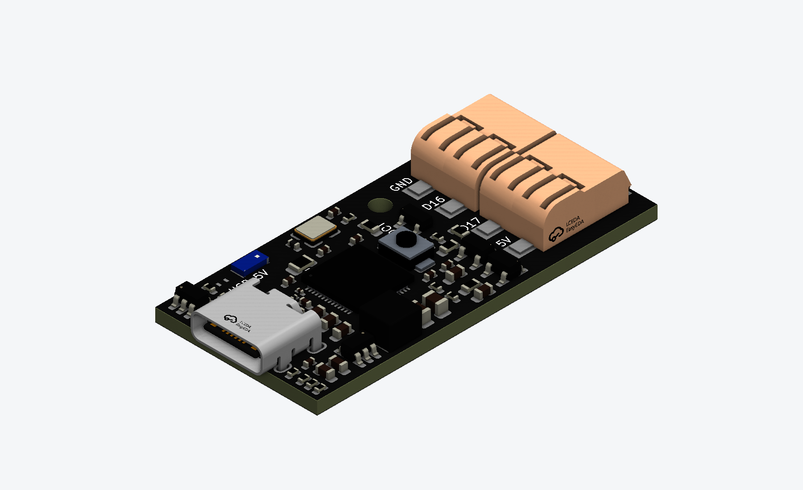
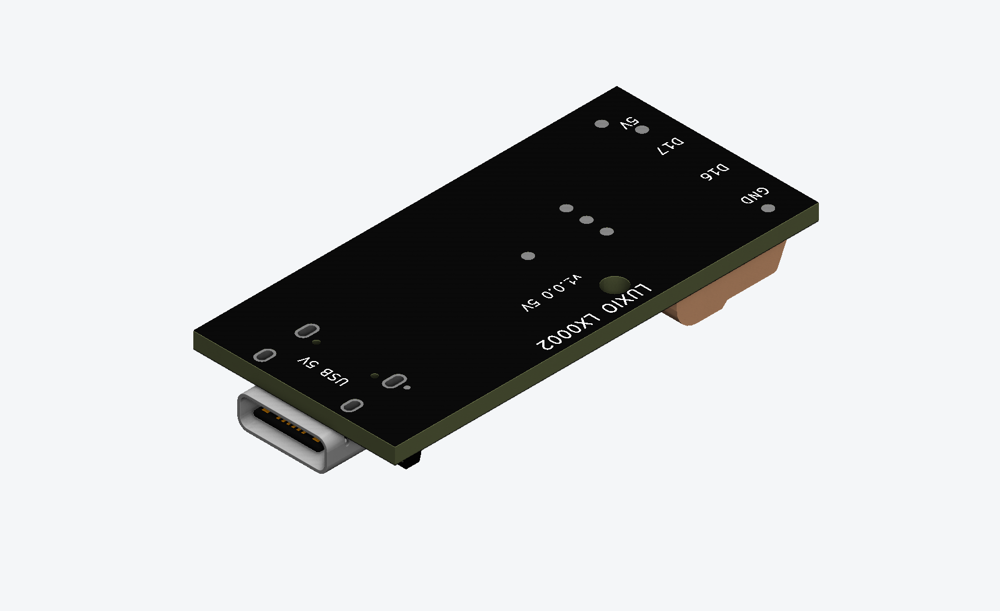
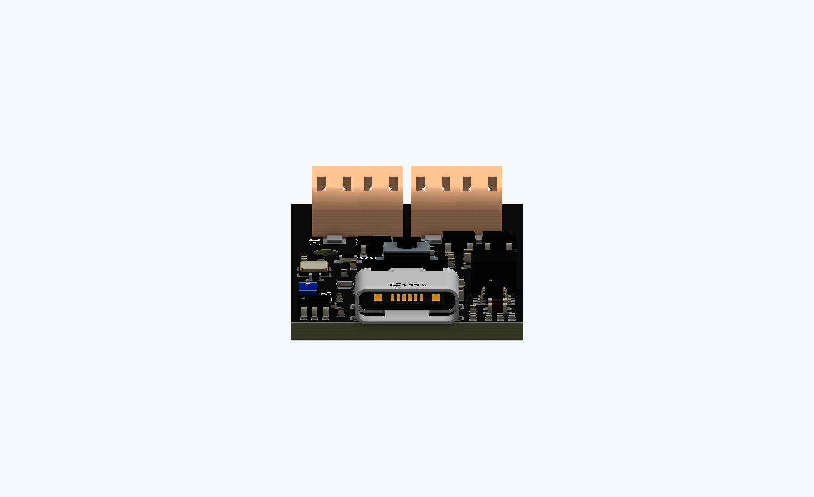
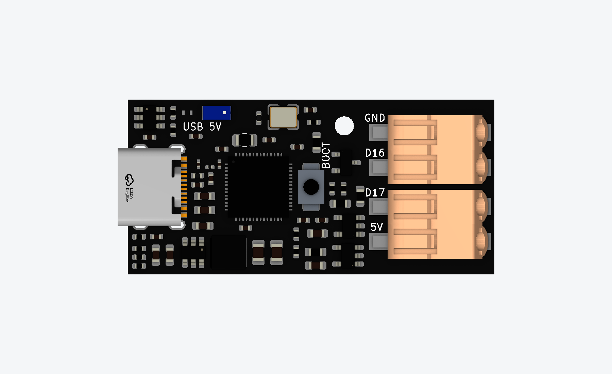
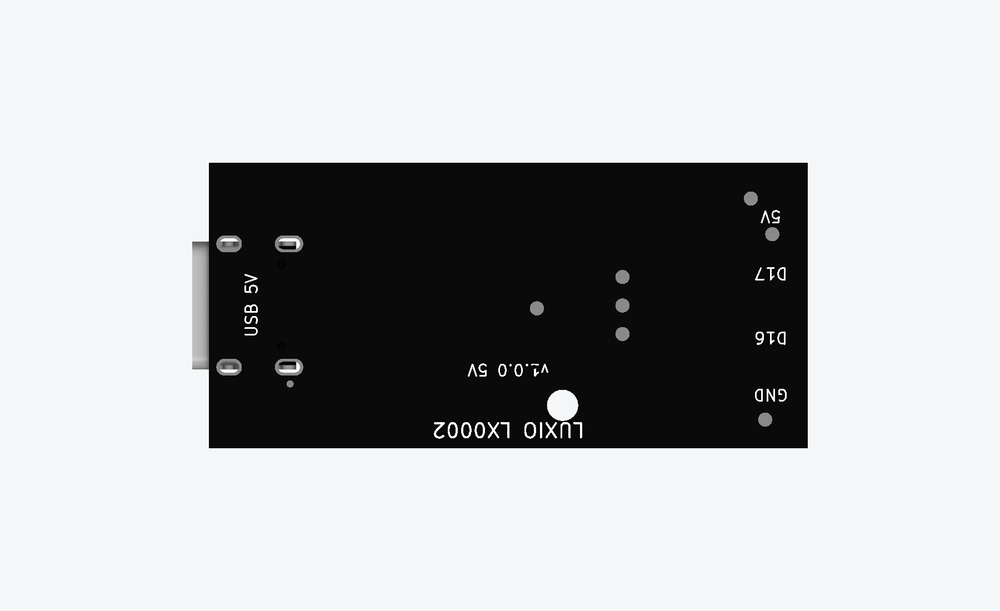
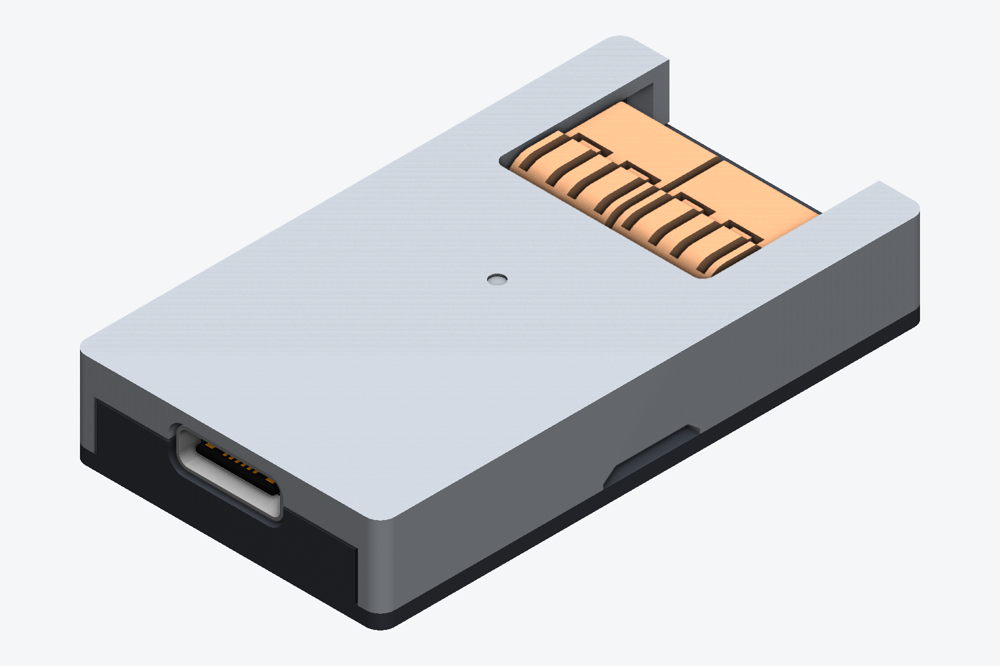
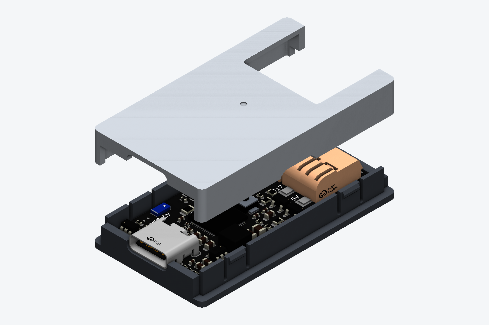
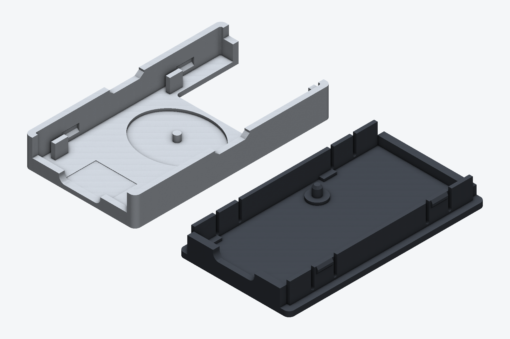

# LX0002

USB-powered ESP32-S3 controller with two 5V LED data outputs. The PCB is 42×20mm, with components assembled on the top only.

**Status: PCB fabrication files and enclosure CAD checked. First-article hardware and printed-fit testing remain.**

## PCB

| Isometric top | Isometric underside | Input end |
| --- | --- | --- |
|  |  |  |
|  |  | |

| Item | Specification |
| --- | --- |
| Board | 42×20×1.6mm FR-4, two copper layers, 1oz copper |
| Assembly | 55 fitted components, top side only |
| Appearance | Black solder mask, white silkscreen, OSP |
| Processor | ESP32-S3FH4R2, 4MB in-package flash and 2MB in-package PSRAM |
| Wireless | 2.4GHz Wi-Fi with ceramic antenna |
| Input | Centered USB-C, 5V power and native USB 2.0 data |
| Strip power | Direct USB5V pass-through; no power-path diode or current limiter |
| Data | GPIO16 and GPIO17, always-enabled 3.3V-to-5V AHCT buffers |
| Button | Centered BOOT / GPIO18, active-low |
| Wire connectors | Two HDGC 2060-452-HDGC blocks, C55251566 |
| USB connector | DEALON USB-TYPE-C-018, C2927038 |
| Retention | One 2.2mm locating hole and case edge captures |
| Via drill | 0.30mm minimum |

[Gerbers](PCB/v1.0.0/Export/LX0002-v1.0.0-Gerbers.zip) · [BOM](PCB/v1.0.0/Export/JLCPCB-BOM.csv) · [Placement file](PCB/v1.0.0/Export/JLCPCB-CPL.csv) · [Schematic](PCB/v1.0.0/Export/schematic.pdf) · [Populated STEP](PCB/v1.0.0/Export/LX0002-assembled.step)

[Complete JLCPCB package](PCB/v1.0.0/Export/LX0002-v1.0.0-JLCPCB.zip)

Native ERC, DRC, schematic parity and open-connection checks report zero findings. Independent checks cover pad connectivity, drill-to-paste clearance, antenna clearance and ground beneath the RF and crystal traces. The two-layer layout retains 95.3% contiguous bottom ground beneath the processor’s exposed pad, with nine central ground vias; a narrow BOOT-route clearance at its edge is a documented departure from Espressif’s complete-ground recommendation. See the [RF review](PCB/v1.0.0/Export/rf-reference-check.json) and [first-article checks](PCB/v1.0.0/Source/first-article-validation.md). CAD checks do not qualify assembled RF performance or temperature.

Viewed from above with USB on the left, the output contacts run **GND, D16, D17, 5V** from top to bottom. GPIO17 can carry a second data channel or a clock signal, depending on the firmware and strip.

USB powers both the controller and a **5V strip**. There is no external DC input, voltage conversion for the strip, USB PD, or onboard current clamp. The connector is rated **3A total**, including the controller; use a regulated 5V adapter and cable rated for the combined load. A computer port may provide less current. The two CC pins each have a separate 5.1kΩ pull-down.

### GPIO

| GPIO | Function | Notes |
| --- | --- | --- |
| 0 | BOOT button | Hold during reset or power-up for ROM download mode |
| 16 | LED data 1 | Always-enabled 5V level shifting, 100Ω output resistor |
| 17 | LED data 2 / clock | Always-enabled 5V level shifting, 100Ω output resistor |
| 18 | User button | Active-low; shares BOOT button through isolation diodes |
| 19 | USB D− | Native USB |
| 20 | USB D+ | Native USB |
| 26–32 | In-package flash / PSRAM | Reserved; no external memory traces |
| 46 | Boot strap | Pulled low; reserved |
| 45 | Unused | FH4R2 fixes its memory supply at 3.3V |
| 21, 43, 44 | Unused | No power-enable control or UART testpads |

Power and buffer enables need no firmware configuration. Firmware generates strip data on GPIO16/17. Pressing the button on a running controller does not reset it. See the [firmware interface](PCB/v1.0.0/Source/firmware-interface.txt).

## Casing

Two screwless PLA parts, **45.45×25.60×7.90mm**, with a flexible BOOT button, rounded USB-C opening and access to all four terminal release buttons. Print with a **0.4mm nozzle, 0.1mm layers, supports off**. CAD fit and supportless slicing are checked; physical fit and latch/button force remain untested.

| Closed | Exploded | Inside |
| --- | --- | --- |
|  |  |  |

[Download all case files](Enclosure/v1.0.0/Export/LX0002-case.zip) · [Print layout 3MF](Enclosure/v1.0.0/Export/Case/LX0002-case-print-layout.3mf) · [Base STL](Enclosure/v1.0.0/Export/Case/base.stl) · [Lid STL](Enclosure/v1.0.0/Export/Case/lid.stl) · [SketchUp](Enclosure/v1.0.0/Export/Case/LX0002-case.skp) · [STEP](Enclosure/v1.0.0/Export/Case/LX0002-case-assembly.step) · [Instructions](Enclosure/v1.0.0/Export/Case/README.md)

## Files

| | Source | Assets | Export |
| --- | --- | --- | --- |
| PCB v1.0.0 | [KiCad project and tools](PCB/v1.0.0/Source/) | [Datasheets and analysis](PCB/v1.0.0/Assets/) | [Manufacturing files and renders](PCB/v1.0.0/Export/) |
| Enclosure v1.0.0 | [Parametric model and tools](Enclosure/v1.0.0/Source/) | [PCB reference models](Enclosure/v1.0.0/Assets/) | [Print files, CAD and renders](Enclosure/v1.0.0/Export/) |

Open [LX0002.kicad_pro](PCB/v1.0.0/Source/LX0002.kicad_pro) with KiCad 10. Connector models come from the JLCEDA/EasyEDA library; the shared HRO USB model approximates the DEALON connector. Its manufacturer drawing governs mechanical fit. The FH4R2 model uses Espressif's nominal package dimensions. Antenna and switch models are simplified previews.
