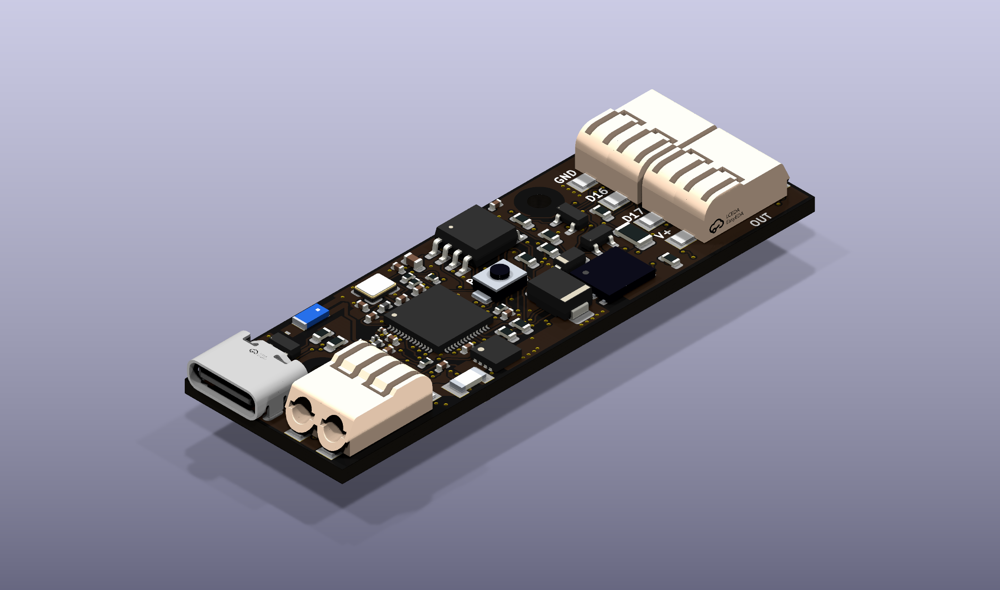
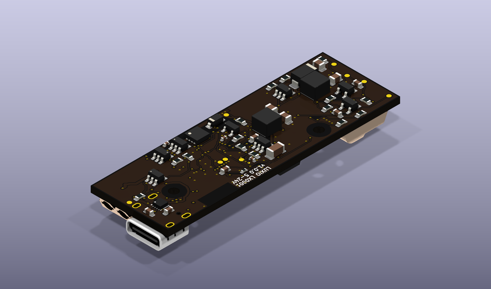

# Luxio hardware

## LX0001 · v1.0.0

A compact ESP32-S3 controller for addressable LED strips, with two 5 V logic
outputs, Wi-Fi, native USB and automatic wired-input priority.

### 3D views

**Top — isometric, USB bottom left / outputs top right**

**Underside — isometric**

[Input-end view](LX0001/v1.0.0/Export/preview-centered-input-end.png) ·
[Top assembly drawing](LX0001/v1.0.0/Export/assembly-top.png) ·
[Bottom assembly drawing](LX0001/v1.0.0/Export/assembly-bottom.png)

### Hardware

| Item | Specification |
| --- | --- |
| Board | 60 × 20 mm, 4 layers, 1.6 mm FR-4 |
| Appearance | Black solder mask, white silkscreen, ENIG |
| MCU | ESP32-S3, external 4 MB flash, no PSRAM |
| Wireless | 2.4 GHz Wi-Fi with ceramic antenna |
| Wired input | 5–24 V DC; designed for a 5 A continuous strip load, pending thermal validation |
| USB | USB-C, native USB 2.0 data and 5 V power; no USB PD |
| LED signals | GPIO16 and GPIO17 translated from 3.3 V to 5 V |
| Button | Centered BOOT / GPIO18 user button |
| Wire connectors | HDGC 2060-452-HDGC, JLCPCB C55251566 |
| USB connector | GCT USB4215-03-A, JLCPCB C37616412 |
| Mounting | Two 2.2 mm holes for M2 screws |
| Fabrication | 0.30 mm minimum via drill; assembly on both sides |

USB-C and the two-wire input sit side by side on top at the same end. The two
output terminals sit at the opposite end. Viewed from above with input on the
left, input order is **GND, VCC** and output order is **GND, GPIO16, GPIO17, VCC**
from top to bottom. GPIO17 can be a second data channel or a clock signal,
depending on firmware and strip type.

### Power behavior

- A powered two-wire input supplies both controller and strip and takes
  priority over USB. USB remains available for data.
- USB alone powers the controller at 5 V. Firmware must explicitly enable
  strip power, and only for a configured 5 V strip.
- A 12 V or 24 V strip requires a matching wired supply. The board cannot
  automatically identify a strip's rated voltage and does not convert the
  output supply to a different strip voltage.
- USB current is limited to about 0.44 A by default, or about 1.28 A after
  firmware verifies a suitable Type-C source. The controller and strip share
  that budget. The 5 A wired-input target does not apply to USB power.

Firmware is not included. See the [firmware interface](LX0001/v1.0.0/Source/firmware-interface.txt)
for pin assignments, startup sequencing, source-current sensing and boot recovery.
Hold the button during reset or power-up to enter ROM download mode; pressing
it alone does not reset a running controller.

### Enclosure

The button center is **(30, 10) mm**. Mounting-hole centers are **(9.5, 8) mm**
and **(42, 3) mm**, measured from the top-left board corner. Use screw heads
or standoffs no larger than 4.4 mm in diameter. Keep metal away from the
antenna and provide cable strain relief.

The USB mouth projects 0.50 mm beyond the input edge; the wire-entry face is
0.75 mm inside that edge. Account for the 1.25 mm difference when designing
case openings. Exact coordinates and antenna clearance are in
[mechanical.json](LX0001/v1.0.0/Source/mechanical.json).

Connector STEP models are from the **JLCEDA/EasyEDA Official Library**
([JLCEDA](https://lceda.cn/), [EasyEDA](https://easyeda.com/)). The HDGC model
is linked to the exact part. C37616412 links to a shared USB model named
`USB-C-SMD_GT-USB-7010B`; its body and shell-stake geometry match the selected
GCT drawing, but it is not a manufacturer-authenticated GCT model. Other
custom part models may be simplified. Use drawings and first articles to
verify enclosure fit. [Model provenance and alignment](LX0001/v1.0.0/Source/connector-model-update.json).

### Manufacturing and status

[Download the JLCPCB release package](LX0001/v1.0.0/Export/LX0001-v1.0.0-JLCPCB.zip).
Upload the Gerber ZIP, BOM and CPL together, using the included
[order settings](LX0001/v1.0.0/Export/JLCPCB-order-settings.txt). The current
release contains 109 fitted components: 50 top and 59 bottom; L104 is DNP.

The saved design passes ERC, DRC, schematic/PCB parity and the independent
drill-to-paste check, with zero open connections or mechanical DRC exceptions.
All 231 routing vias have 0.30 mm drills. Copper-loss estimates include all
four layers; they are not thermal qualification.

**Status: fabrication data checked; hardware not yet production-qualified.**
Build and validate first articles before the planned 100-board lot. Electrical,
5 A thermal, RF, USB and assembly acceptance steps are recorded in
[first-article validation](LX0001/v1.0.0/Source/first-article-validation.txt).
No fabrication order has been placed.

### Files

- [Source](LX0001/v1.0.0/Source/): editable KiCad project, schematic, PCB,
  local footprints/models, electrical notes and verification/export tools.
- [Assets](LX0001/v1.0.0/Assets/): datasheets, supplier models and review evidence.
- [Export](LX0001/v1.0.0/Export/): current Gerbers, BOM/CPL, schematic PDF,
  assembly drawings, renders and validation records.

Open [LX0001.kicad_pro](LX0001/v1.0.0/Source/LX0001.kicad_pro) with KiCad 10.
The saved PCB is the final routed design; development placement/router scripts
are not a one-command rebuild recipe. See [tool notes](LX0001/v1.0.0/Source/tools/README.txt).
Historical files under `Assets/review-history` are not manufacturing inputs.
